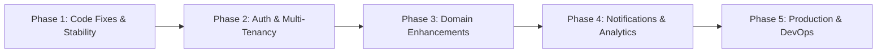

# JobPulse: Comprehensive Project Analysis, Feature Audit & Roadmap

**Project Name:** JobPulse (Job Application & Interview Tracker)  
**Author / Maintainer:** Akshay  
**Document Purpose:** Complete assessment of accomplishments, architecture, missing real-world features, identified bugs, and prioritized engineering roadmap.

---

## 1. Executive Summary

**JobPulse** is a full-stack Spring Boot web application engineered to solve a common, high-friction problem: tracking job applications and interview progression in a centralized dashboard. 

The application implements an **N-Tier architecture** (Controller $\rightarrow$ Service $\rightarrow$ Repository $\rightarrow$ Database) with a MySQL relational database managed via Spring Data JPA. It provides soft deletion, paginated queries, an automated interview status engine, and a frontend dashboard for real-time tracking.

While the foundation is solid, typical commercial or production-grade job tracking platforms (such as Huntr, Teal, or Simplify) incorporate user authentication, document storage (resumes/cover letters), salary tracking, recruiter contact management, calendar alerts, and funnel analytics.

---

## 2. Current Architecture & Implemented Features

### 2.1 Backend Architecture & Technology Stack
* **Language & Runtime:** Java 17
* **Framework:** Spring Boot (Web MVC, Spring Data JPA)
* **Database:** MySQL with `mysql-connector-j`
* **Object Mapping:** Hibernate ORM with auto-schema generation (`ddl-auto=update`)
* **Utilities:** Lombok (reducing boilerplate for accessors and constructors)
* **Frontend:** Static HTML5, CSS3, and Vanilla JavaScript served directly from Spring Boot (`src/main/resources/static`)

### 2.2 Core Accomplishments & Capabilities

| Feature Area | Current Implementation Details | Status |
| :--- | :--- | :--- |
| **Job Application CRUD** | Create, Read, Update, and Soft-Delete applications with company name, role, location, job link, priority (`HIGH`, `MEDIUM`, `LOW`), status (`ACTIVE`, `OFFER`, `REJECTED`), applied date, and notes. | ✅ Accomplished |
| **Audit Timestamps** | Entities track `createdAt` and `updatedAt` automatically using JPA lifecycle callbacks (`@PrePersist`, `@PreUpdate`). | ✅ Accomplished |
| **Soft Delete Pattern** | Deleting an application updates `isDeleted = true` instead of dropping rows, preserving audit history and relational integrity. | ✅ Accomplished |
| **Interview Rounds Tracking** | A dedicated `Round` entity in a 1-to-many relationship with `JobApplication` (`@OneToMany` cascade ALL, orphanRemoval). Tracks round name, sequence order, date, notes, and round status (`PENDING`, `CLEARED`, `FAILED`). | ✅ Accomplished |
| **Automated Status Workflow** | `RoundService` automatically syncs the parent application status when rounds change: <br>• If any round is `FAILED` $\rightarrow$ Job marked `REJECTED`<br>• If all rounds are `CLEARED` $\rightarrow$ Job marked `OFFER`<br>• Otherwise $\rightarrow$ Job remains `ACTIVE`. | ✅ Accomplished |
| **Database Pagination** | Built-in pagination (`/api/jobs/paginated?page=0&size=10`) using Spring Data `Pageable` sorted by `createdAt` descending, returning a standardized `PaginatedResponse<T>` DTO. | ✅ Accomplished |
| **Global Error Handling** | `@RestControllerAdvice` (`GlobalExceptionHandler`) intercepts `ResourceNotFoundException` and uncaught exceptions, formatting standard JSON responses with timestamps and HTTP status codes. | ✅ Accomplished |
| **CORS Configuration** | `CorsConfig` implements `WebMvcConfigurer` to permit cross-origin requests across all standard HTTP methods. | ✅ Accomplished |
| **Interactive UI** | Fast, zero-dependency dashboard (`dashboard.html`) featuring KPI summary cards, badge-coded statuses, quick search, status/priority dropdown filters, and a sliding drawer for managing interview rounds. | ✅ Accomplished |

---

## 3. Critical Missing Features in Real-World Job Trackers

The following sections highlight standard features expected in enterprise or portfolio-grade application trackers that are currently absent in JobPulse:

### 3.1 Authentication, Authorization & Multi-Tenancy (High Priority)
* **Single-Tenant / Shared Data:** Currently, any user navigating to the application shares the same global database. There is no concept of personal user spaces.
* **Missing Spring Security:** No security filter chain, session management, or CSRF/CORS protections tailored to authenticated contexts.
* **Missing User Entity:** A `User` table (storing username, email, encrypted password with BCrypt) is required.
* **Row-Level Security (Data Isolation):** Each `JobApplication` must have a `user_id` foreign key constraint so users only view and alter their own applications.
* **Social Authentication:** Integration with OAuth2 / OpenID Connect (e.g., "Sign in with Google" or "Sign in with GitHub") allows frictionless onboarding.

### 3.2 Data Model & Domain Expansions
Real-world trackers capture several additional metadata points to assist job seekers:

1. **Document & File Management:**
   * Tracking which resume version was submitted (e.g., `Resume_Java_Backend_2026.pdf`).
   * Storing offer letters, compensation packages, and assignment briefs.
   * *Missing stack:* Multipart file upload endpoints backed by AWS S3, Cloudflare R2, or local secure storage.
2. **Compensation & Salary Tracking:**
   * Base pay, currency, stock/equity grants, bonuses, and expected compensation range.
3. **Work Arrangements & Source:**
   * Work mode: `REMOTE`, `HYBRID`, or `ON_SITE`.
   * Application source: `LinkedIn`, `Indeed`, `Referral`, `Company Careers Site`, `Campus Placement`.
4. **Recruiter & Contact CRM:**
   * Contact name, title, email, phone number, and LinkedIn URL for recruiters or hiring managers.
5. **Expanded Lifecycle Statuses:**
   * Real hiring processes need statuses beyond `ACTIVE`, `OFFER`, and `REJECTED`:
     * `WISHLIST` (Not yet applied)
     * `APPLIED` (Awaiting initial review)
     * `OA_IN_PROGRESS` (Online coding challenge)
     * `INTERVIEWING` (Phone screen / technical rounds)
     * `OFFER_RECEIVED`
     * `OFFER_ACCEPTED` / `OFFER_DECLINED`
     * `WITHDRAWN`
     * `GHOSTED` (No response after 30+ days)

### 3.3 Reminders, Follow-Ups & Calendar Integration
* **Interview Reminders:** Email or in-app alerts 24 hours and 1 hour before scheduled interview rounds.
* **Follow-up Triggers:** Automated alerts for applications lingering in `APPLIED` status for over 10 business days ("Time to send a follow-up email to the recruiter").
* **Calendar Sync:** `.ics` file generation or Google Calendar API integration to add interview rounds directly to the candidate's personal schedule.

### 3.4 Visual Analytics & Funnel Insights
* **Recruitment Funnel Visualization:**
  $$\text{Applications (100\%)} \longrightarrow \text{Assessments (30\%)} \longrightarrow \text{Interviews (15\%)} \longrightarrow \text{Offers (5\%)}$$
* **Interactive Charts:** Visualizing application cadence per week/month, average response duration, and acceptance/rejection ratios using Chart.js or Recharts.

### 3.5 Production Engineering, DevOps & API Contracts
* **Interactive API Documentation:** Missing OpenAPI 3 / Swagger (`springdoc-openapi-starter-webmvc-ui`) for testing endpoints at `/swagger-ui.html`.
* **Testing Suite:** Currently, only an empty `contextLoads()` test exists. Unit tests for `JobService` / `RoundService` (using Mockito/JUnit 5) and integration tests with `@WebMvcTest` / `@SpringBootTest` are needed.
* **Externalized Configuration:** Credentials in `application.properties` are hardcoded (`root` with blank password). Production deployments need environment variable binding (`${DB_PASSWORD}`) and profile separation (`dev`, `prod`).
* **Containerization:** Missing `Dockerfile` and `docker-compose.yml` for unified multi-container startup (Spring Boot + MySQL).

---

## 4. Identified Bugs & Code Improvements

During codebase review, the following implementation discrepancies were identified:

1. **Status Omission in `JobService.updateJob()`:**
   * In `JobService.java`, the update routine updates company, role, location, link, priority, date, and notes, but omits:
     ```java
     existing.setStatus(updatedJob.getStatus());
     ```
     As a result, manually changing the status of a job via a `PUT` request is silently ignored.
2. **Missing `@Valid` in Controller Endpoints:**
   * Even though entity fields contain validation annotations like `@NotBlank` and `@NotNull`, `JobController.java` lacks `@Valid` on `@RequestBody JobApplication job`. Bean validation is not executed automatically before persisting.
3. **Client-Side Filtering vs. Server-Side Pagination Mismatch:**
   * In `dashboard.html`, the search and filter functions operate exclusively on the `allJobs` JavaScript variable—which only holds the current page (10 items). If a company exists on Page 2, the search bar on Page 1 will return no results. Filtering should be performed at the SQL query level via repository query parameters.
4. **Dashboard KPI Metric Discrepancy:**
   * The KPI count cards for *Active*, *Offers*, and *Rejected* are calculated using `.filter()` on the current page array, while *Total Applied* displays the database total elements. This leads to inconsistent counter values whenever total applications exceed the page size.

---

## 5. Prioritized Engineering Roadmap



### Phase 1: Stability & Core Fixes (Immediate)
* Add `existing.setStatus(updatedJob.getStatus())` in `JobService`.
* Add `@Valid` to controller request bodies and introduce a custom validation failure handler in `GlobalExceptionHandler`.
* Migrate search and filters to backend query parameters (`/api/jobs/paginated?company=...&status=...&priority=...`).
* Expose an aggregate statistics endpoint (`/api/jobs/stats`) returning accurate overall counts.

### Phase 2: Security & Multi-Tenancy
* Add `spring-boot-starter-security` and `jjwt` (Java JWT).
* Implement `User` and `Role` entities.
* Add registration and login endpoints (`/api/auth/register`, `/api/auth/login`).
* Attach `userId` to `JobApplication` and enforce row-level security on all database queries.

### Phase 3: Domain Expansion
* Expand the `JobStatus` enum with real-world stages (`WISHLIST`, `APPLIED`, `OA`, `INTERVIEWING`, `OFFER_ACCEPTED`, etc.).
* Add salary compensation fields, work mode, and recruiter contact fields.
* Add file upload support (`/api/jobs/{id}/attachments`) for resume versions and offer letters.

### Phase 4: User Experience, Notifications & Analytics
* Add email notifications (Spring Mail) or browser push notifications for interview rounds.
* Implement application pipeline / Kanban board view (Drag-and-drop cards between stages).
* Integrate Chart.js on the dashboard to visualize recruitment funnel metrics.

### Phase 5: DevOps & Deployment
* Add `springdoc-openapi` for Swagger UI documentation.
* Write comprehensive unit and integration tests (JUnit 5 + Mockito + Testcontainers).
* Create a multi-stage `Dockerfile` and `docker-compose.yml` with environment-specific profiles.
